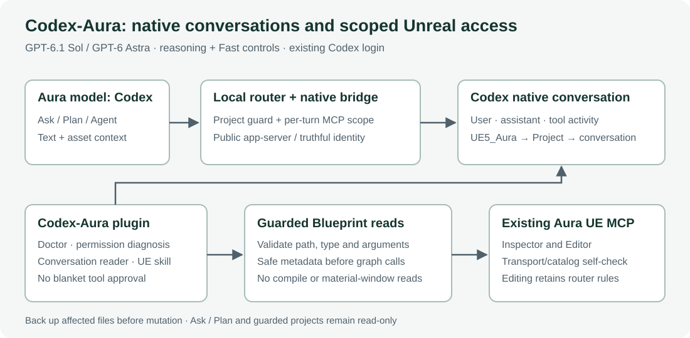
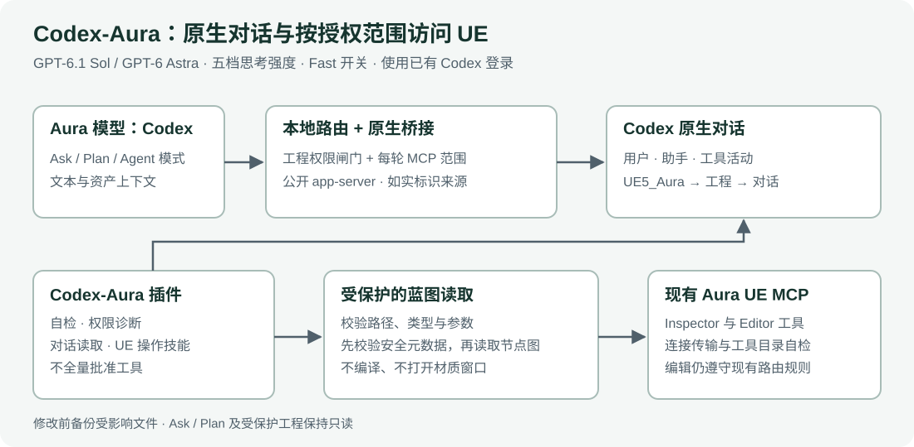

# Codex-Aura

[English](#english) · [简体中文](#中文说明)

[Full English guide](docs/README.en.md) · [中文完整说明](docs/README.zh-CN.md) · [Release notes / 中英文更新记录](docs/RELEASE_NOTES.md) · [MIT License](LICENSE)

## English

Adds **Codex** to Aura's model picker, uses the existing Codex login with **GPT-6.1 Sol or GPT-6 Astra**, and saves real conversations through the public Codex app-server protocol. The composer lets you select a model, reasoning effort, and Fast mode for each turn; the default is Sol / Ultra with Fast off. Includes six read-only MCP tools and three skills for diagnostics, Blueprint inspection and Unreal workflows.



### Latest update · 2026-10-10

Choose the model, reasoning effort, and Fast mode directly in Aura's composer:

| Setting | Available choices | Default |
| --- | --- | --- |
| Model | GPT-6.1 Sol / GPT-6 Astra | GPT-6.1 Sol |
| Reasoning effort | Low / Medium / High / Extra High / Ultra | Ultra |
| Fast mode | Independent lightning toggle; a filled icon indicates On | Off |

Select **Codex** in Aura's model menu, then click the model / effort button below the message box. Choose a model, drag the effort slider, and use the lightning button to toggle Fast. Selections are saved locally and apply to the next message, including in an existing conversation. Reset restores **Ultra** while keeping the selected model and Fast setting. The Fast tooltip shows `Fast mode` / `More usage`.

The current source passed **all 216 regression tests** on 2026-10-10, including per-turn settings on new and continued conversations, UI state, and installation / restoration. Existing installations can use the [quick-start commands](#quick-start) below to install the new controls, then reload the router and refresh Aura.

### Save fix in 0.1.5

Fixes **“This chat could not be saved”** on a new conversation. A fresh Codex thread may have no persisted rollout before its first turn. The bridge now records the actual thread identity and completes generation before optional Project/workspace/title synchronization. That synchronization shares one five-second deadline, and errors preserve the completed answer. Cloud save receipts must still pass validation before a turn is reported as committed.

The 0.1.5 live verification confirmed both a new conversation and a continuation were saved and could be read back.

### Requirements

This is an integration patch for an existing **Aura 1.0.6 / DSH router** setup. It requires Windows, Node.js, a signed-in Codex CLI, the Aura Unreal plugin and an existing custom compatible `AuraChatTap.mjs` router. The repository does not include those products or the complete router, and installing DSH-Aura alone does not provide it.

Tested with Node.js 24.14.1. Earlier native-protocol checks used Codex CLI 0.159.2; the 0.1.5 plugin-load and save checks used 0.159.0-alpha.12.1. Installation stops when known patch anchors do not match. See the [full English guide](docs/README.en.md) for compatibility and permission boundaries.

### Quick start

Create `config.local.json` in the repository root, using actual local paths:

```json
{
  "auraRoot": "C:\\Apps\\aura-client",
  "routerRoot": "C:\\Tools\\AuraRouter",
  "routerUrl": "http://127.0.0.1:41777",
  "testProject": "C:\\Projects\\MyGame",
  "cliPath": ""
}
```

`routerRoot` must contain the compatible router. `testProject` is diagnostic configuration and does not grant UE write access. Set `CODEX_AURA_CONFIG` before starting Codex, or use the default `%LOCALAPPDATA%\Aura\CodexAura\config.json`. Installer `--config` selects the file for that installation and does not persist an environment variable for desktop processes.

```powershell
$env:CODEX_AURA_CONFIG = (Resolve-Path .\config.local.json).Path
node .\codex-aura\scripts\install.mjs --config .\config.local.json --dry-run
node .\codex-aura\scripts\install.mjs --config .\config.local.json
```

Keep the returned `backupDir`. Backups default to `%LOCALAPPDATA%\Aura\CodexAura\backups`; `--backup-root` overrides it. Reload the existing router, open a new Codex chat or restart Codex to refresh tools, and refresh Aura before selecting **Codex**. The [full English guide](docs/README.en.md) covers installation, restoration and Project organization.

### Usage and development

Ask Codex to “Check Aura MCP and permissions,” “Show Aura conversations,” or “Explain this Blueprint.” All six plugin MCP tools are read-only. Ask/Plan stay read-only; Agent edits still depend on the existing router's authorization and exact project scope.

The code uses Node.js built-in modules without npm dependencies. Run the isolated regression suite from the repository root:

```powershell
npm test
```

`codex-aura/` contains the plugin, MCP, skills, installer and restoration tools. `codex-model/` contains the model-picker patch, native conversation bridge and guard tests. Functionality and workflows reference [DSH-Aura](https://github.com/TaoKing2023/DSH-Aura); see [third-party notices](THIRD_PARTY_NOTICES.md).

## 中文说明

让 Aura 的模型菜单选择 **Codex**，使用已有 Codex 登录调用 **GPT-6.1 Sol 或 GPT-6 Astra**，并在 Codex 中查看真实对话。输入框底部可选择模型、思考强度及 Fast 加速，每轮生效；默认 Sol / Ultra，Fast 关闭。提供 MCP 自检、权限诊断、蓝图结构读取和 UE 操作技能。



### 最新更新 · 2026-10-10

在 Aura 输入框底部直接选择模型、思考强度和 Fast 模式：

| 设置 | 可选项 | 默认值 |
| --- | --- | --- |
| 模型 | GPT-6.1 Sol / GPT-6 Astra | GPT-6.1 Sol |
| 思考强度 | Low / Medium / High / Extra High / Ultra | Ultra |
| Fast 模式 | 闪电按钮独立开关，实心图标表示已开启 | 关闭 |

先在 Aura 模型菜单选择 **Codex**，再点击输入框底部的模型 / 思考强度按钮。弹窗内可切换模型、拖动思考强度滑条、点击闪电切换 Fast。选择保存在本机，并在下一条消息生效；已有对话续聊也能切换。重置按钮只恢复 **Ultra**，保留模型和 Fast 选择。Fast 提示显示 `Fast mode` / `More usage`。

当前源码于 2026-10-10 完成回归，**216 项全部通过**，覆盖新对话及续聊的每轮参数、界面状态和安装 / 恢复。已有安装可重新执行下方[快速开始](#快速开始)中的预览及安装命令，再重新加载路由并刷新 Aura，以安装新增控件。

### 0.1.5 对话保存修复

修复新对话提示 **“This chat could not be saved”** 的问题。新 Codex 线程在首轮生成前可能尚未落盘；现在先保存真实线程标识并完成生成，再关联 Project、同步工作区和标题。可选同步共用 5 秒期限，失败时保留回答。云端保存回执仍必须校验成功，不能把失败当成已保存。

0.1.5 发布时已完成新对话及第二轮续聊的实际保存、读回验证。

### 安装前提

本项目是现有 **Aura 1.0.6 / DSH 路由的集成补丁**。需要 Windows、Node.js、已登录的 Codex CLI、Aura UE 插件和兼容的 `AuraChatTap.mjs`。仓库不包含这些产品或完整路由。

测试环境为 Node.js 24.14.1；原生协议曾在 Codex CLI 0.159.2 验证，0.1.5 的插件加载和保存验证使用 0.159.0-alpha.12.1。Aura 更新后如补丁位置不匹配，安装器会停止。详细限制及操作边界见[中文说明](docs/README.zh-CN.md)。

### 快速开始

在仓库根目录创建 `config.local.json`，替换为本机实际路径：

```json
{
  "auraRoot": "C:\\Apps\\aura-client",
  "routerRoot": "C:\\Tools\\AuraRouter",
  "routerUrl": "http://127.0.0.1:41777",
  "testProject": "C:\\Projects\\MyGame",
  "cliPath": ""
}
```

`routerRoot` 必须指向兼容的路由目录。`testProject` 是诊断配置，不授予 UE 写权限。自定义配置应在启动 Codex 前通过 `CODEX_AURA_CONFIG` 指定，或放到默认 `%LOCALAPPDATA%\Aura\CodexAura\config.json`；`--config` 仅选择本次安装文件。

```powershell
$env:CODEX_AURA_CONFIG = (Resolve-Path .\config.local.json).Path
node .\codex-aura\scripts\install.mjs --config .\config.local.json --dry-run
node .\codex-aura\scripts\install.mjs --config .\config.local.json
```

保存安装结果的 `backupDir`。默认备份位于 `%LOCALAPPDATA%\Aura\CodexAura\backups`，可用 `--backup-root` 指定其他位置。重新加载已有路由，在 Codex 新开对话或重启以更新工具目录，在 Aura 刷新后选择 **Codex**。完整安装、恢复和 Project 分类步骤见[中文说明](docs/README.zh-CN.md)。

### 使用与开发

在 Codex 请求“检查 Aura MCP 和权限”“查看 Aura 对话”或“解释这个蓝图”。6 个 MCP 工具均只读；Ask / Plan 保持只读，Agent 编辑仍依赖现有路由授权和真实工程范围。

代码只使用 Node.js 内置模块，无需安装 npm 依赖。在仓库根目录运行隔离回归测试：

```powershell
npm test
```

`codex-aura/` 包含插件、MCP、技能和安装 / 恢复；`codex-model/` 包含模型菜单补丁、原生对话桥接及 guard 测试。参考 [DSH-Aura](https://github.com/TaoKing2023/DSH-Aura) 的功能与操作规范，第三方边界见 [THIRD_PARTY_NOTICES.md](THIRD_PARTY_NOTICES.md)。
